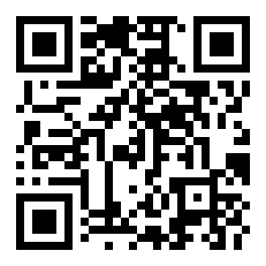

# AIOTEK LINE 打卡系統：新進同仁使用說明

公司用 LINE 打卡，不用另外裝 App。第一次使用要先花約 5 分鐘綁定帳號，之後每天開 LINE 按一下就能打卡。

---

## 一、事前準備

- 手機已安裝 LINE，並且能登入
- 公司 Email（`@aiotek.com.tw`）可以收信
- 員工卡號：8 碼英數字，印在識別證上或向 HR 索取（暫時沒有也可以先略過）
- 手機的定位功能保持開啟（打卡時需要）

---

## 二、第一次使用：綁定帳號

### 步驟 1：加入公司 LINE 官方帳號

用以下任一方式加入官方帳號「**Aiotek Bot**」為好友：

- 用 LINE 掃描 QR Code：

  

- 在手機上直接點連結：<https://line.me/R/ti/p/@999oqqdc>
- 在 LINE「加入好友 → 搜尋 → ID」輸入 **`@999oqqdc`**（記得要加 `@`）

加入後，機器人會傳來歡迎訊息與設定步驟。

### 步驟 2：傳送公司 Email

在聊天室直接輸入你的公司 Email，例如：

```
name@aiotek.com.tw
```

- 只能使用 `@aiotek.com.tw` 的信箱，其他信箱會被拒絕
- 機器人回覆「已將驗證碼傳送至…」後，到公司信箱收信

### 步驟 3：回傳 6 位數驗證碼

把信中的 6 位數驗證碼傳回聊天室，例如 `123456`。

- 驗證碼 **10 分鐘內有效**
- 最多可以輸入錯誤 **5 次**，超過後要重新傳送 Email 取得新的驗證碼
- 收不到信時，先檢查垃圾郵件匣；過期的話，重新傳一次 Email 即可

看到「✅ 帳號綁定完成！」就表示綁定成功。

### 步驟 4：設定員工卡號

把 8 碼員工卡號傳到聊天室，例如：

```
01234567
```

看到「✅ 員工卡號已設定為：…」即完成。

- 暫時沒有卡號：傳送「**略過**」，之後可以在打卡頁面的「個人資料」補填
- **卡號沒設定的話，打卡紀錄不會傳到工廠打卡系統**，拿到卡號後請盡快補上

---

## 三、每天打卡

### 開啟打卡頁面

在公司官方帳號的聊天室，點下方選單「**開啟打卡系統**」。

第一次開啟時，LINE 會詢問是否允許存取，以及是否允許取得位置，請都選「允許」。

### 上班打卡

點「**上班打卡**」，等待畫面顯示成功訊息。

### 下班打卡

點「**下班打卡**」。

- 當天要先打過上班卡，才能打下班卡
- 上班時數未滿 8 小時，系統會再確認一次，確定要下班就按「確定下班」

### 打卡規則

- 每天上班、下班**各只能打一次**，重複打卡會被擋下
- 日期以台灣時間為準，跨過午夜 00:00 就算隔天
- 系統會記錄打卡的時間（以伺服器時間為準，改手機時間沒有用）、GPS 位置與網路 IP

---

## 四、查看出勤紀錄

在打卡頁面點「**出勤紀錄**」，可以看到：

- 本月每天的上班、下班時間
- 每日加班時數與本月加班累計

工時算法：當天第一次上班到最後一次下班，**固定扣 1 小時午休**，超過 8 小時的部分才算加班；加班以 30 分鐘為單位，不足 30 分鐘不計。

---

## 五、忘記打卡：補打卡

1. 打卡頁面點「**補打卡**」
2. 選擇日期，系統會顯示當天已有的紀錄，並建議要補「上班」或「下班」
3. 填寫實際的時間與原因
4. 勾選「我已確認類型與時間正確」，按「送出申請」
5. 等待主管審核，核准後紀錄就會出現在出勤紀錄裡

注意：

- 只能補過去的時間，不能補未來
- 如果選的類型跟系統建議不同，或當天紀錄已經完整，系統會再請你確認一次
- 同一個時間不要重複送出申請

---

## 六、修改員工卡號

打卡頁面點「**個人資料**」→ 輸入新的 8 碼卡號 →「儲存卡號」。

卡號不能與其他同仁重複；若顯示已被使用，請聯絡管理員。

---

## 七、常見問題

| 狀況 | 處理方式 |
| --- | --- |
| 輸入 Email 後顯示「只接受公司 Email」 | 確認是 `@aiotek.com.tw` 結尾的信箱 |
| 顯示「此 Email 已被其他帳號綁定」 | 你的 Email 已綁在別的 LINE 帳號上（例如換手機或換 LINE 帳號），請聯絡管理員 |
| 顯示「驗證碼無效或已過期」 | 重新傳送公司 Email，取得新的驗證碼 |
| 收不到驗證信 | 檢查垃圾郵件匣；仍收不到請聯絡管理員 |
| 打卡時顯示「無法取得定位」 | 到手機設定開啟 LINE 的定位權限，並確認手機定位已開啟 |
| 打卡時顯示「帳號未綁定」 | 回到第二節完成 Email 綁定 |
| 下班打卡顯示「今日尚未上班打卡」 | 當天沒有上班紀錄，請先用補打卡補上班，再打下班卡 |
| 顯示「已打卡，請勿重複操作」 | 今天已經打過這一種卡了，可到「出勤紀錄」確認 |
| 畫面顯示「系統已更新」 | 關掉打卡頁面，重新從選單開啟 |
| 其他錯誤 | 關掉重開一次；仍有問題請截圖給管理員 |

---

有任何問題，請聯絡管理員：________（請填入聯絡人）
